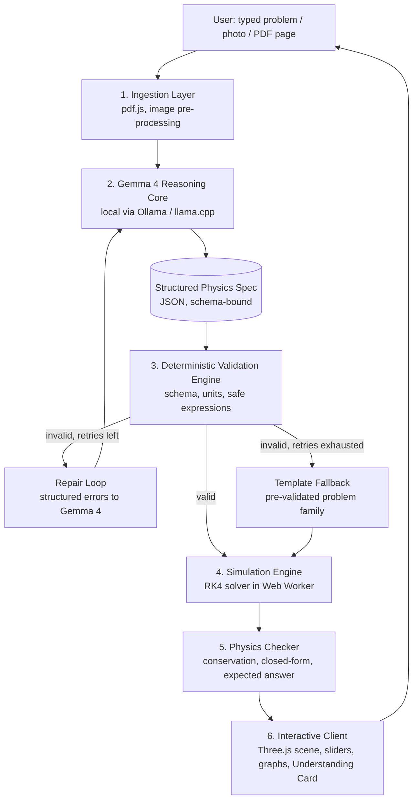
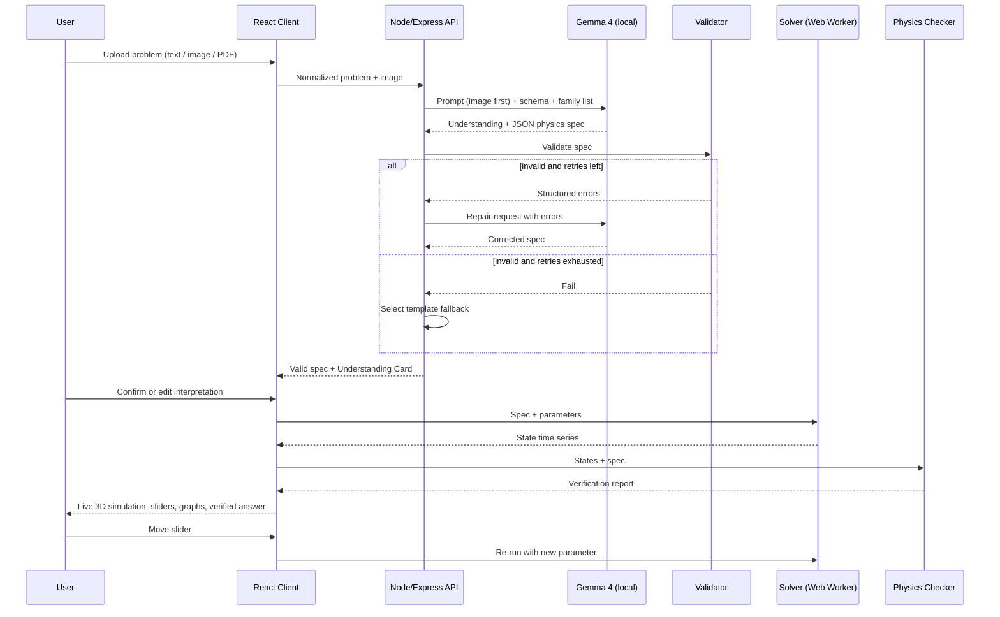
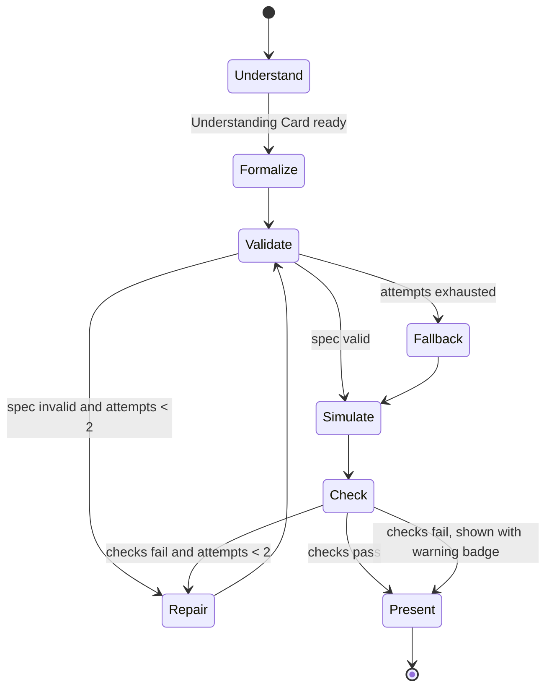

# SpatiaSTEM

> **Turn any STEM problem into a live, verified 3D simulation, powered by Gemma 4 running locally.**

*Hacktober Fest | Open Source AI Hackathon | Organized by Elevate*
*Track: Best Use of Gemma 4 / Gemma 4 Open-Source*
*Round: Qualifier (technical proposal, README only)*

---

## Table of Contents

1. [Project Name](#1-project-name)
2. [Problem Statement](#2-problem-statement)
3. [Project Overview](#3-project-overview)
4. [Proposed Solution](#4-proposed-solution)
5. [Objectives](#5-objectives)
6. [Target Users / Use Case](#6-target-users--use-case)
7. [Open-Source AI Technology Selected](#7-open-source-ai-technology-selected)
8. [Why This Technology Was Selected](#8-why-this-technology-was-selected)
9. [AI's Role in the System](#9-ais-role-in-the-system)
10. [System Architecture](#10-system-architecture)
11. [Component-Level Architecture](#11-component-level-architecture)
12. [Data / Information Flow](#12-data--information-flow)
13. [Agentic Workflow](#13-agentic-workflow)
14. [Technology Stack](#14-technology-stack)
15. [Expected Features](#15-expected-features)
16. [Implementation Approach](#16-implementation-approach)
17. [Expected Final Output](#17-expected-final-output)
18. [Future Scope / Scalability](#18-future-scope--scalability)
19. [Open-Source Dependencies / Components](#19-open-source-dependencies--components)
20. [Expected Challenges and Mitigation](#20-expected-challenges-and-mitigation)

---

## 1. Project Name

**SpatiaSTEM**: *Spatial STEM Simulation Engine*

Tagline: *"Don't just read the problem. Watch it happen."*

---

## 2. Problem Statement

Physics and mechanics are spatial and dynamic, yet students meet them as static text, equations and hand-drawn diagrams on paper.

| Pain point | Who feels it | Why it persists |
|---|---|---|
| A free-body diagram or field diagram is hard to imagine in motion | School and early-college students | Textbooks cannot animate, and most simulators need manual setup |
| Existing simulators cover only a fixed set of pre-built scenarios | Students and teachers | A new problem means finding or building a new simulation |
| Students cannot tell whether their numeric answer matches what physically happens | Self-learners | No immediate feedback loop between the formula and the behavior |
| Most AI tools respond with a long text explanation | Everyone | Text does not build spatial intuition, and the answer may be wrong with no way to check it |
| Quality STEM help is often in English only and needs internet | Students in regional-language and low-connectivity settings | Cloud-hosted tools assume bandwidth and English |

**Core gap:** nothing today takes *the problem a student is actually stuck on* (text plus diagram) and turns it, within seconds, into an interactive simulation whose physics is **verified**, not just generated.

---

## 3. Project Overview

SpatiaSTEM is a local-first web workbench. The user uploads a problem (typed text, photo, or PDF page). **Gemma 4** reads the problem and diagram, identifies the physical setup, and produces a **structured physics specification**: bodies, forces, parameters, initial conditions and governing equations. A deterministic simulation engine then runs that specification and a Three.js client renders it as an interactive 3D scene with parameter sliders.

The key design decision is that **the AI never writes executable code that the browser runs.** Gemma 4 produces a constrained, schema-validated *description* of the physics. A fixed, tested solver and renderer do the simulation. This keeps the system safe, fast and, most importantly, **verifiable**.

---

## 4. Proposed Solution

SpatiaSTEM is a four-stage pipeline:

1. **Understand**: Gemma 4 reads the problem text and the diagram (multimodal) and states its interpretation in a short, editable "Understanding Card".
2. **Formalize**: Gemma 4 emits a JSON physics spec (problem family, entities, forces, equations as expression trees, units, initial conditions, and the quantity the problem asks for).
3. **Verify**: A deterministic validator checks the spec (schema, units, safe expressions) and after solving checks the physics (conservation laws, closed-form comparison, and the problem's own expected answer when given).
4. **Visualize**: A Three.js client renders the simulation, with sliders bound to the spec's parameters, vector overlays (force, velocity), live graphs, and a verified numeric answer.

If validation fails, a bounded **repair loop** returns structured errors to Gemma 4. If it still fails, the system falls back to a pre-validated template for the detected problem family rather than showing something wrong.

---

## 5. Objectives

| # | Objective | Measurable target (final hackathon) |
|---|---|---|
| O1 | Convert a problem (text + optional diagram) into a valid physics spec | At least 80% schema-valid specs on our benchmark set after at most 2 repair attempts |
| O2 | Produce physically correct simulations | At least 85% of generated simulations pass conservation / closed-form checks |
| O3 | Verify the answer to the problem itself | Show a match or mismatch against the expected answer for problems that provide one |
| O4 | Run fully locally with an open model | Complete demo with no cloud API calls |
| O5 | Make simulations interactive | Live sliders, vector overlays and graphs at a smooth frame rate on a laptop |
| O6 | Support regional-language learning | Hindi and Marathi explanation summaries alongside English |

*Targets are goals to be measured on our own benchmark in the final; we will report actual numbers honestly, including failures.*

---

## 6. Target Users / Use Case

| User | Need | How SpatiaSTEM helps |
|---|---|---|
| **Class 11-12 / first-year engineering students** | Build intuition for mechanics and electromagnetism problems | Drop in a problem, see it move, tweak parameters |
| **Competitive-exam aspirants** | Check their reasoning and numeric answers | Verified answer vs. simulated result |
| **Teachers** | Quickly build a live demo for tomorrow's lesson | Type or upload a problem, project the simulation |
| **Students in low-connectivity or regional-language settings** | A tool that works offline and explains in Hindi / Marathi | Local Gemma 4 and multilingual summaries |

**Primary use case:** *A student photographs a textbook problem of a block on an incline with friction. Within seconds they see the block slide, adjust the angle and friction coefficient with sliders, and see that the computed acceleration matches the textbook answer.*

---

## 7. Open-Source AI Technology Selected

**Gemma 4** (Google DeepMind, open-weight, Apache 2.0).

| Aspect | Detail |
|---|---|
| Primary model | A Gemma 4 instruction-tuned variant for reasoning and structured output |
| Default local variant | A small "E" variant (E4B) for laptop-class hardware |
| Optional higher-quality variant | A larger variant (26B A4B or 31B) for machines with more GPU memory |
| Serving (local) | Ollama or llama.cpp |
| Capabilities used | Text + image input, configurable thinking mode, native function calling / structured output, native system prompt, long context |

*Exact variants and quantizations will be confirmed against the official Gemma 4 model card at build time, and the system is designed so the model name is a configuration value.*

---

## 8. Why This Technology Was Selected

| Requirement from the problem | Gemma 4 capability | Why it matters |
|---|---|---|
| Read a problem **and** its diagram | Multimodal text + image input | The diagram carries axes, angles and given quantities that text alone misses |
| Derive governing equations | Strong math and reasoning with configurable thinking mode | We can switch deeper reasoning on for derivation and off for fast steps |
| Emit a strict machine-readable contract | Native function calling and structured output | The simulation engine needs valid JSON, not prose |
| Work offline, privately and free | Open weights, Apache 2.0, local inference | Suits students without reliable internet, with no per-call cost |
| Run on student hardware | Small efficient variants plus larger optional ones | Same pipeline scales from laptop demo to stronger GPU |
| Explain in regional languages | Multilingual capability | Hindi and Marathi summaries for learners |

**Why open source specifically:** the verification pipeline needs to be inspectable and reproducible, the tool should run in classrooms with no internet, and students and teachers should be able to host it themselves at no cost. A closed hosted API would break all three.

**Choice driven by the problem, not popularity:** we need a multimodal model with reliable structured output that can run locally. Gemma 4 is the open model family that combines those properties.

---

## 9. AI's Role in the System

Gemma 4 is **the interpreter and formalizer**, not the simulator and not a chatbot.

| Task | Done by Gemma 4? | Done by deterministic code? |
|---|---|---|
| Read problem text and diagram | Yes | |
| Classify the problem family | Yes | Validated against a known list |
| Extract given quantities and units | Yes | Unit-checked by code |
| Express forces and equations as an expression tree | Yes | Parsed and whitelisted by code |
| Run the simulation (numerical integration) | | Yes (fixed solver) |
| Render the scene | | Yes (fixed Three.js renderer) |
| Check conservation laws / closed-form answer | | Yes (validator) |
| Write multilingual explanation | Yes | |
| Repair its own spec from validator errors | Yes (bounded retries) | |

**Why AI is necessary:** the space of possible problems, phrasings and diagrams is open-ended. Hand-written parsers cannot read a photographed textbook problem; a language-vision model can. **Why AI alone is not enough:** unverified model output cannot be trusted for physics, so every spec passes through deterministic checks before the user sees it.

---

## 10. System Architecture

**Layering principle:** four decoupled layers (ingestion, reasoning, deterministic engine, client) so that a model error can never crash the browser or silently show wrong physics.

---

## 11. Component-Level Architecture

| # | Component | Responsibility | Input | Output |
|---|---|---|---|---|
| C1 | **Ingestion Service** | Accept text, image or PDF; render PDF pages to images; extract text | File / text | Normalized problem text + image(s) |
| C2 | **Prompt Builder** | Build system and user prompts (images placed before text), attach schema and family list | Normalized input | Model request |
| C3 | **Gemma 4 Inference Server** | Local multimodal reasoning and structured output | Model request | Raw JSON spec + explanation draft |
| C4 | **Spec Validator** | JSON schema check, unit consistency, expression whitelist, bounds and clamping | Raw spec | Valid spec or structured error list |
| C5 | **Repair Controller** | Feed validator errors back to Gemma 4 (max 2 attempts) | Error list | Corrected spec request |
| C6 | **Template Library** | Pre-validated parametric models per problem family (fallback and reference) | Family + parameters | Safe spec |
| C7 | **Simulation Engine** | Fixed-step RK4 integration of the spec's equations in a Web Worker | Valid spec | Time series of states |
| C8 | **Physics Checker** | Energy / momentum drift, closed-form comparison, expected-answer match | Time series + spec | Verification report (pass / fail + numbers) |
| C9 | **Renderer** | Three.js scene, vector overlays, orbit controls, live graphs | States + spec | Interactive 3D view |
| C10 | **UI Layer** | Upload, Understanding Card (editable), sliders, language toggle, verification badge | User events | Re-simulation requests |
| C11 | **Explanation Generator** | Short step-by-step explanation in English / Hindi / Marathi | Spec + report | Localized text |
| C12 | **Session Store** (optional) | Save solved problems and specs for reuse | Spec + report | Saved gallery |

---

## 12. Data / Information Flow

**Data contract (illustrative).** The spec is a constrained JSON document, not code. Its main fields:

| Field | Meaning |
|---|---|
| `family` | One of the supported problem families (e.g. `projectile`, `incline_friction`, `damped_oscillator`, `charged_particle_EB`) |
| `entities` | Bodies with mass / charge and initial position and velocity (with units) |
| `forces` | List of forces, each an expression tree over whitelisted symbols and functions |
| `parameters` | Named parameters with min, max and default (these become sliders) |
| `target_quantity` | What the problem asks for (e.g. acceleration, range, period) |
| `expected_answer` | The textbook answer, if given in the problem |
| `explanations` | Short summaries per language |

---

## 13. Agentic Workflow

SpatiaSTEM uses a small, bounded agent loop instead of a free-form agent.

**Tools exposed to Gemma 4 (function calling):**

| Tool | Purpose |
|---|---|
| `submit_physics_spec` | Return the final structured spec (schema-enforced) |
| `lookup_template` | Retrieve the parameter structure of a supported problem family |
| `evaluate_expression` | Test an expression numerically in the safe evaluator before committing |
| `unit_check` | Verify dimensional consistency of an equation |

**Guardrails:** hard cap on repair attempts; no network or file tools; the model cannot execute code; failed verification is shown to the user with a warning rather than hidden.

---

## 14. Technology Stack

| Layer | Technology | Purpose |
|---|---|---|
| Frontend | React + Vite | UI, upload, sliders, Understanding Card |
| 3D rendering | Three.js | Scene, vector arrows, orbit controls |
| Graphs | Lightweight chart library | Live plots (position, velocity, energy) |
| Math rendering | KaTeX | Display equations |
| Backend | Node.js + Express | API, orchestration, repair controller |
| Schema validation | JSON Schema / Zod | Strict spec contract |
| Expression handling | math.js (restricted evaluation) | Safe parsing of expression trees |
| Simulation | Custom RK4 solver in a Web Worker | Deterministic physics |
| PDF handling | pdf.js | Render pages and extract text |
| AI model | **Gemma 4** (open weights) | Multimodal reasoning and structured output |
| Inference runtime | Ollama / llama.cpp | Local serving |
| Storage (optional) | MongoDB or a local file store | Saved sessions and gallery |
| Packaging | Docker Compose | One-command local run |

---

## 15. Expected Features

**Core (committed for the final):**

- Text, image and PDF-page problem input
- Editable **Understanding Card** showing how Gemma 4 interpreted the problem
- Four supported problem families, each end to end: **projectile motion**, **incline with friction**, **damped oscillator / pendulum**, **charged particle in electric and magnetic fields**
- Live parameter sliders, vector overlays (force, velocity), and real-time graphs
- **Verification badge:** conservation checks, closed-form comparison, and match against the expected answer when the problem provides one
- Bounded self-repair loop with template fallback
- English plus Hindi / Marathi explanation summaries
- Fully local operation (no cloud API)

**Stretch (only if time permits):**

- Additional families (circular motion, simple circuits, collisions)
- Experimental free-form mode, clearly labeled "unverified"
- Shareable simulation link
- Side-by-side comparison of two parameter sets

---

## 16. Implementation Approach

The final hackathon is short, so the plan is a thin vertical slice first, then breadth.

| Phase | Work | Outcome |
|---|---|---|
| **P0: Model feasibility** | Test Gemma 4 locally on sample problems (text, then diagrams); pick default variant | Confirmed model and prompt format |
| **P1: Contract** | Define the spec schema, whitelisted symbols and function list, template for one family | Spec contract + validator |
| **P2: Vertical slice** | One family end to end: input, Gemma 4, validator, solver, Three.js render | Working demo with projectile motion |
| **P3: Verification** | Add conservation checks, closed-form comparison and expected-answer match | Verification badge |
| **P4: Breadth** | Add the other three families and their templates | Four verified families |
| **P5: Resilience** | Repair loop, template fallback, error UX | Graceful failures |
| **P6: Polish** | Hindi / Marathi summaries, UI cleanup, Docker packaging, demo script | Demo-ready build |

**Evaluation plan:** a benchmark of roughly 40 textbook-style problems (about 10 per family, with some diagram-based) with known answers. We will report schema-valid rate, physics-verified rate, answer-match rate and latency, for each model variant tested.

**Team workflow:** the architecture is split so work can proceed in parallel (UI and renderer, solver and checker, model and prompts), connected only by the JSON contract.

---

## 17. Expected Final Output

A working, locally runnable web application with the following behavior in the live demo:

1. The evaluator uploads or types a problem from one of the supported families.
2. Within seconds, an Understanding Card shows the interpretation.
3. An interactive 3D simulation appears with adjustable sliders and live graphs.
4. A verification badge shows the physics checks and whether the simulated answer matches the expected one.
5. The explanation can be switched between English, Hindi and Marathi.
6. The same flow works with no internet connection.

**Deliverables:** public GitHub repository (open-source license), Docker Compose setup, benchmark problem set with results, and a short demo walkthrough.

---

## 18. Future Scope / Scalability

| Direction | Description |
|---|---|
| More domains | Waves and optics, thermodynamics, fluid flow, orbital mechanics, circuits |
| Chemistry and biology | Reaction kinetics curves, population dynamics via the same spec-and-solver pattern |
| Teacher tools | Class sets of problems, shareable simulations, answer-checking assignments |
| Adaptive tutoring | Gemma 4 asks "what if" questions based on slider interactions |
| Mobile / edge | Run the smallest Gemma 4 variants on-device for fully offline phones |
| Fine-tuning | Fine-tune a small model on validated (problem, spec) pairs collected from successful runs |
| Community template library | Open contributions of new problem families as validated spec templates |
| Performance | GPU-based integration for large particle or field simulations once the CPU solver is the bottleneck |

**Extensibility by design:** adding a new problem family means adding a schema entry, a template and a checker. No changes to the model, renderer or pipeline are needed.

---

## 19. Open-Source Dependencies / Components

| Component | Role | Why needed |
|---|---|---|
| **Gemma 4** (Apache 2.0) | Multimodal reasoning and structured spec generation | Core AI of the system |
| **Ollama / llama.cpp** | Local model serving | Offline, private inference |
| **Three.js** | 3D rendering | Interactive scene |
| **React + Vite** | Frontend | UI |
| **Node.js + Express** | Backend | Orchestration |
| **math.js** | Safe expression parsing | Avoid arbitrary code evaluation |
| **Zod / JSON Schema** | Spec validation | Strict contract |
| **pdf.js** | PDF page rendering and text | Input handling |
| **KaTeX** | Equation display | Readable math |
| **Docker / Docker Compose** | Packaging | Reproducible setup |

The project's own code will be published under an open-source license in a public GitHub repository, as the final round expects.

---

## 20. Expected Challenges and Mitigation

| # | Challenge | Risk | Mitigation |
|---|---|---|---|
| 1 | **Misreading diagrams or handwriting** | Wrong setup silently simulated | Understanding Card lets the user confirm or correct the interpretation; typed-text path always available; diagram-based problems tested early (P0) |
| 2 | **Invalid or inconsistent JSON from the model** | Pipeline breaks | Schema-constrained output, validator, bounded repair loop, template fallback |
| 3 | **Physically wrong but well-formed spec** | Misleading simulation | Physics checker: conservation drift, closed-form comparison, expected-answer match, with visible warning if checks fail |
| 4 | **Numerical instability** (e.g. division by zero near r to 0, stiff systems) | Crashes or garbage output | Parameter clamping, fixed small time step, RK4, divergence detection |
| 5 | **Unsafe expressions from the model** | Code injection risk | Expressions are data (trees), evaluated by a whitelisted evaluator; the model never emits executable code |
| 6 | **Limited hardware for larger models** | Slow or no inference | Default to the small variant; larger variant optional; model name is configuration |
| 7 | **Latency on a laptop** | Poor demo experience | Streaming status updates, thinking mode only for derivation, caching of repeated problems |
| 8 | **Quality of Hindi / Marathi explanations** | Awkward or wrong text | Keep summaries short and templated around verified numbers; label as AI-generated; evaluate on a small sample |
| 9 | **Scope too large for the final** | Unfinished demo | Four families only, vertical slice first, stretch features clearly separated |
| 10 | **Model-serving ecosystem instability** | Setup surprises | Pin exact model and runtime versions; test the serving setup first (P0) |
| 11 | **Overclaiming correctness** | Loss of trust | Show the verification report honestly; mark unverified results; publish benchmark failures too |

---

*This repository intentionally contains only `README.md`, as required for the qualifier round. Implementation will be developed during the final hackathon.*
